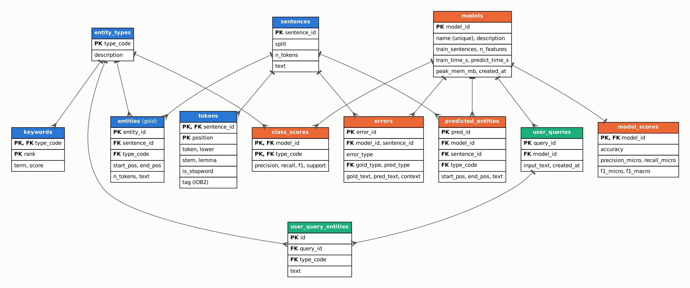
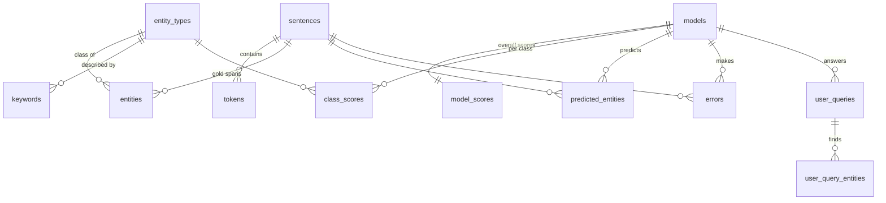

# Named Entity Recognition in Kazakh News (KazNERD)

Final project for *Programming for Data Analysis and Database*
(MSc Applied Artificial Intelligence, Astana IT University) — Cluster 2: Text Analytics & NLP.

The program finds persons, organisations, locations and 22 other entity classes in Kazakh
news sentences. It covers the full path: streaming 1.3 million token rows into an optimised
DataFrame, preprocessing (tokenization, stop words, stemming vs lemmatization), frequency
analysis, a SQLite database with 14 analytical queries, a baseline plus four classical models
and a fine-tuned transformer, error analysis, and an interactive mode where the user types a
sentence and gets the entities back.

## Results at a glance (test split, 11,307 sentences, entity-level seqeval)

| Model | F1 micro | F1 macro | Precision | Recall | Token acc. | Train time | Peak RAM |
|---|---|---|---|---|---|---|---|
| Baseline: most-frequent tag per word | 0.493 | 0.400 | 0.421 | 0.594 | 0.911 | 1 s | +33 MB |
| SGD + Bag-of-Words window ¹ | 0.603 | 0.379 | 0.597 | 0.608 | 0.928 | 32 s | +583 MB |
| SGD + TF-IDF (char 2–4-grams + context) ¹ | 0.613 | 0.372 | 0.583 | 0.646 | 0.930 | 39 s | +413 MB |
| SGD + Word2Vec window ¹ | 0.603 | 0.370 | 0.605 | 0.602 | 0.927 | 322 s | +1,458 MB |
| **CRF (lexical, suffix, stem, shape features)** | **0.931** | **0.823** | **0.941** | **0.922** | **0.982** | 1,044 s | +945 MB |
| XLM-RoBERTa (fine-tuned, `src/transformer_ner.py`) | run on GPU ² | | | | | | |

¹ trained on a 30,000-sentence subsample of train (memory bound); all other models use the full 90,228 sentences.
² see *Transformer* below; the published XLM-RoBERTa result on KazNERD is F1 = 0.9722.

Measured on a 2-core CPU, 8 GB RAM. Every number above is produced by the code and saved in
`reports/results/model_comparison.csv`.

## Data

| | |
|---|---|
| Dataset | [KazNERD](https://github.com/IS2AI/KazNERD) (Yeshpanov et al., LREC 2022), CC BY 4.0 |
| Source | Kazakh television news, manually annotated by two linguists, IOB2 scheme |
| Size | 112,702 sentences · 1,302,352 token rows · 136,353 entity spans · 25 classes (51 tags) |
| Splits | train 90,228 / valid 11,167 / test 11,307 sentences (official split) |
| Extra | [UD Kazakh-KTB](https://github.com/UniversalDependencies/UD_Kazakh-KTB) treebank (CC BY-SA 4.0) — gold lemmas for evaluating stemming vs lemmatization |

The raw files are in `data/raw/` and `data/ud_kazakh/`; if they are missing, the program
downloads them. Parquet, CSV and SQLite files are generated by the program.

## Quick start

Python 3.10+.

```bash
python -m venv .venv
# Windows: .venv\Scripts\activate    Linux/macOS: source .venv/bin/activate
pip install -r requirements.txt      # install torch for your CUDA first, see the file
python main.py                       # interactive menu
```

Run everything without prompts (≈ 30 min on a laptop CPU, most of it CRF training):

```bash
python main.py --run-all
python main.py --step 4              # or a single step
```

### Menu

```
 1 - Prepare data (CoNLL -> Parquet/CSV, dtype optimisation)
 2 - Build SQLite database (corpus, entities, keywords)
 3 - Preprocessing & frequency analysis (stop words, stemming vs lemmatization, n-grams, word clouds)
 4 - Train & evaluate models (baseline, BoW / TF-IDF / Word2Vec, CRF)
 5 - Run analytical SQL queries
 6 - Benchmarks (CSV vs Parquet, Pandas vs SQL)
 7 - Error analysis & confusion matrix
 8 - Recognise entities in your own text
 9 - Show results summary
 0 - Exit
```

Steps must be run in order the first time (1 → 2 → 3 → 4); after that, any step can be
re-run. Example for step 8:

```
Text> Қасым-Жомарт Тоқаев 2024 жылғы 15 наурызда Астанада Ұлттық банктің төрағасы Тимур Сүлейменовпен кездесті.
[Қасым-Жомарт Тоқаев](PERSON) [2024 жылғы 15 наурызда](DATE) [Астанада](GPE) [Ұлттық банктің](ORGANISATION) төрағасы [Тимур Сүлейменовпен](PERSON) кездесті .
```

Every query and its entities are stored in the `user_queries` / `user_query_entities` tables
and appended to `reports/results/user_predictions.csv`.

### Transformer (GPU)

```bash
python -m src.transformer_ner --model xlm-roberta-base --epochs 3 --batch-size 16
# larger model, if the GPU has >= 16 GB:  --model xlm-roberta-large --batch-size 8 --lr 2e-5
```

The script fine-tunes on train, selects the best epoch on valid, evaluates on test and writes
its scores, predictions and errors into the same CSV files and SQLite tables as the other
models, so menu steps 5, 7, 8 and 9 include it automatically. The code path was tested
end-to-end with a tiny randomly initialised model (`python tools/make_tiny_model.py`).

## Project structure

```
main.py                  console menu / CLI
config.py                paths and experiment settings
src/
  data_loader.py         streaming CoNLL reader, dtype optimisation, Parquet/CSV, chunked CSV
  preprocessing.py       tokenizer, stop words, Kazakh stemmer, UD-trained lemmatizer, comparison
  eda.py                 word / n-gram frequencies, entity statistics, context keywords, word clouds
  features.py            BoW, TF-IDF and Word2Vec window features; CRF features
  models.py              baseline, SGD window tagger, CRF tagger (common fit/predict interface)
  transformer_ner.py     XLM-RoBERTa fine-tuning and inference
  evaluation.py          seqeval metrics, confusion matrix, span-level error analysis
  database.py            SQLite schema, loading, storing results, running queries
  sql_queries.py         the 14 analytical queries
  benchmarks.py          CSV vs Parquet, dtype optimisation, Pandas vs SQL
  predict.py             prediction for user text
  pipeline.py            the menu steps
  plotting.py, spans.py, utils.py
sql/schema.sql           database schema
docs/er_diagram.png      ER diagram (source: docs/er_diagram.dot)
tools/make_tiny_model.py tiny model for smoke-testing the transformer script
reports/figures/         all charts (PNG)
reports/results/         all tables (CSV / JSON)
```

## Database





The 14 queries in `src/sql_queries.py` use JOIN (incl. self-join and CROSS JOIN), GROUP BY /
HAVING, CTEs, scalar and EXISTS subqueries and window functions (ROW_NUMBER, RANK, LAG,
SUM OVER); results are loaded into Pandas with `pd.read_sql_query` and saved to
`reports/results/sql_*.csv`.

## How the course requirements are covered

| # | Requirement | Where |
|---|---|---|
| 1 | ≥ 5 functions | every module; e.g. `data_loader.read_conll`, `evaluation.error_analysis`, `database.load_corpus` |
| 2 | lists / dicts | sentence lists, feature dicts, lexicons in `models.LookupBaseline`, `config.ENTITY_TYPES` |
| 3 | if / elif / else | `predict.highlight`, `evaluation.error_analysis`, `main.menu` |
| 4 | loops | CoNLL streaming, menu loop, input retry in `main.choose_model` |
| 5 | files | Parquet, CSV, JSON, SQLite, joblib models, `user_predictions.csv` |
| 6 | try / except | missing files, failed downloads, invalid menu input, SQL errors, optional Stanza |
| 7 | console menu | `main.py` |
| 8 | modules, stdlib | `src/` package; `pathlib`, `json`, `sqlite3`, `datetime`, `argparse`, `urllib`, `re` |
| 9 | ≥ 2 approaches + baseline; quality / time / memory | 5 models + transformer; CSV vs Parquet; Pandas vs SQL; stemming vs lemmatization |
| 10 | SQLite, ER diagram, ≥ 8 queries, Pandas | `sql/schema.sql`, `docs/er_diagram.png`, 14 queries |
| 11 | ≥ 500k rows, memory-aware | 1.3M rows; streaming reader, compact dtypes (72 → 33 MB), Parquet, `chunksize` |
| NLP | tokenization, stop words, stemming vs lemmatization | `preprocessing.py`, menu 3 |
| NLP | frequencies, n-grams, WordCloud / barplot | `eda.py`, `reports/figures/` |
| NLP | BoW vs TF-IDF vs embeddings | `features.WindowVectorizer`, menu 4 |
| NLP | corpus + labels, keywords, entities in SQLite | tables `tokens`, `entities`, `keywords`, `predicted_entities` |
| NLP | Accuracy, F1-macro, seqeval | `evaluation.evaluate` |
| NLP | confusion matrix, error analysis | `evaluation.type_confusion`, `evaluation.error_analysis`, menu 7 |
| NLP | user input → prediction | menu 8 |

## Notes and limitations

* NLTK and spaCy have no Kazakh stemmer or lemmatizer, so the project implements a rule-based
  suffix stemmer (as an NLTK `StemmerI`) and a lemmatizer that learns suffix rules from UD
  Kazakh-KTB gold lemmas. If `stanza` with its Kazakh model is installed, it is added to the
  comparison automatically (note: Stanza's model was trained on the same treebank).
* The UD test portion used for that comparison is small (1,668 word tokens).
* The SGD window taggers classify each token independently and are trained on 30k sentences;
  their gap to the CRF mixes both effects. The Word2Vec model hit the iteration limit
  (`ConvergenceWarning`).
* All models are deterministic except Word2Vec, which trains on 2 threads: a re-run gave
  F1 0.598 instead of 0.603. Times and memory vary a little with the machine.
* Scores use seqeval's default (conlleval-compatible) mode.

## Licence and citation

KazNERD: CC BY 4.0 — Yeshpanov R., Khassanov Y., Varol H. A. *KazNERD: Kazakh Named
Entity Recognition Dataset.* LREC 2022, pp. 417–426. UD Kazakh-KTB: CC BY-SA 4.0.
